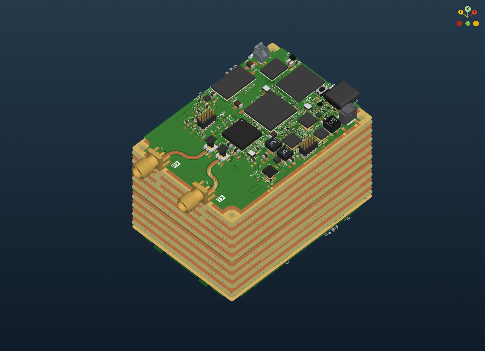
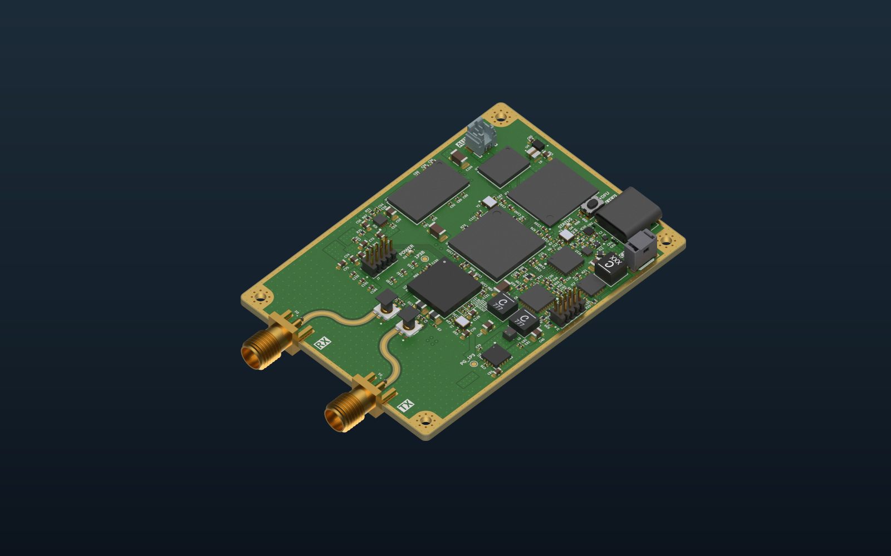
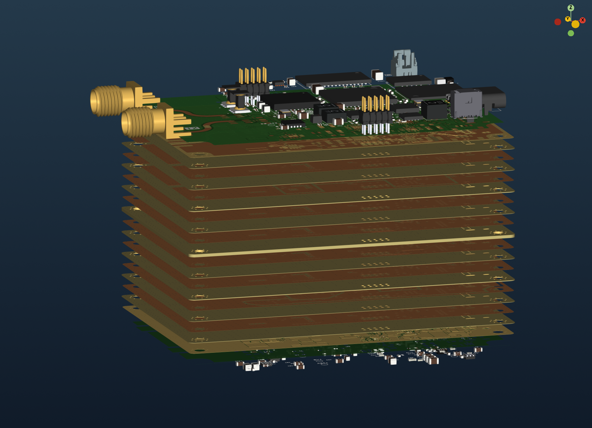
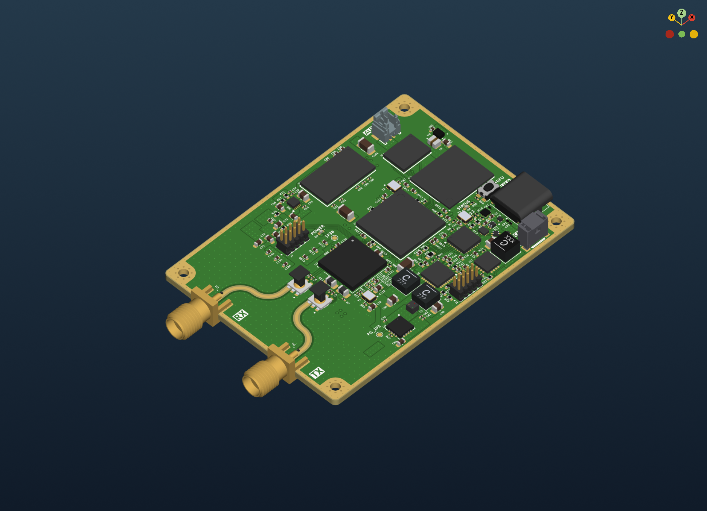
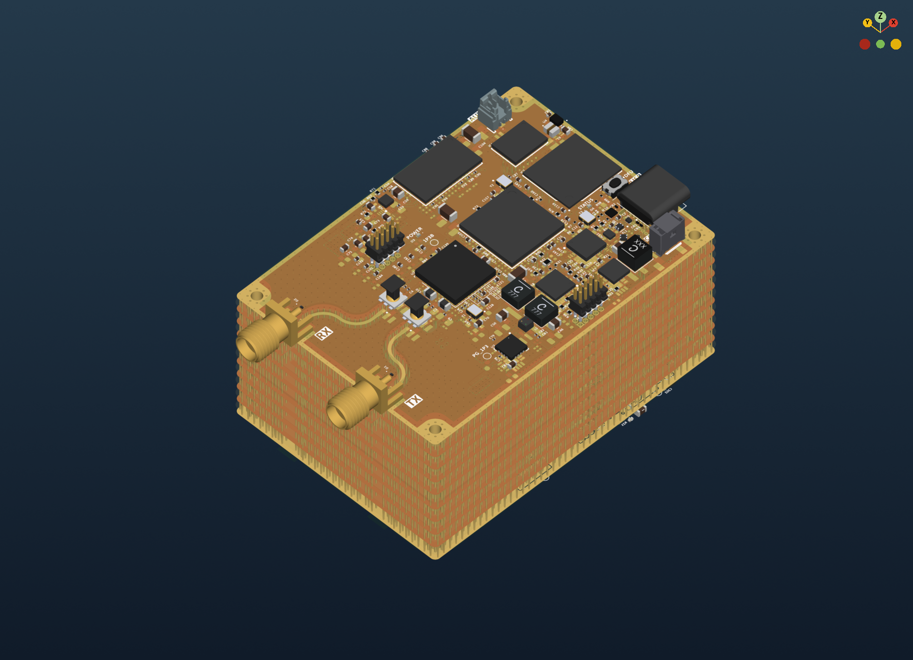
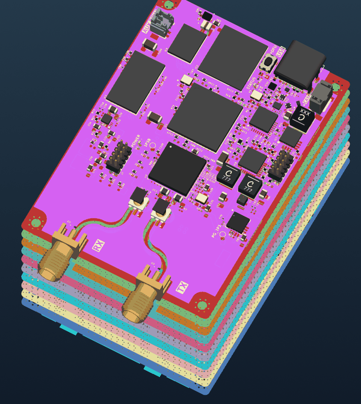
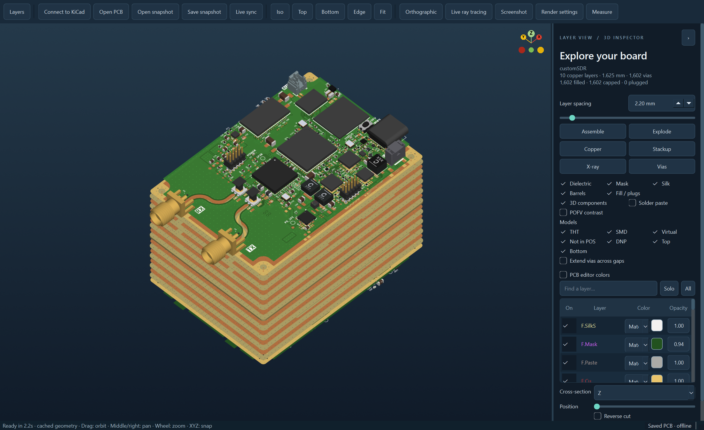

# Layer View — exploded 3D PCB viewer for KiCad

[](https://github.com/Ross0907/kicad-layer-view/actions/workflows/ci.yml)
[](https://www.kicad.org)
[](LICENSE)

A KiCad 10 IPC plugin that opens a separate 3D window following the active PCB
editor — including unsaved edits — and lets you pull the board apart into its
physical copper, dielectric, solder-mask, silkscreen and paste layers.



*A 10-layer software-defined-radio board, exploded into its physical layers.*

## Features

- **Exploded stackup.** Spread every physical layer apart with one slider, or
  animate between assembled and exploded. Copper, dielectric, mask, silk and
  paste are real solids at their stackup thickness and height.
- **Looks like the fabricated board.** Colors come from the board stackup and
  default to a realistic style referenced to JLCPCB production boards: real
  resist pigments and opacity (black is a matte, nearly opaque black; green
  shows the copper pattern), natural FR4 at the edges, white legend ink (black
  on white resist), bare copper under the resist and the plating finish only on
  exposed copper — ENIG/ENEPIG gold, OSP copper, immersion silver/tin, and HASL
  when the stackup names no finish. Finishes and plated 3D-model parts are
  physically based metals that reflect a studio environment. A **KiCad 3D viewer** style reproduces
  KiCad's own palettes and rules exactly. Custom `#RRGGBB(AA)` colors are kept
  exactly; each layer can switch to the PCB editor theme color or a custom one.
- **KiCad-style rendering.** KiCad's OpenGL material model and light rig, its
  background gradient, smooth shading on round holes, vias and board edges, and
  fast antialiasing while moving and 32× accumulated antialiasing (shown
  progressively) as soon as the view is still.
- **Everything at once.** A newly opened board appears complete — every layer
  plus the STEP/VRML footprint models — instead of loading in stages.
- **Fast.** Copper layers of large boards mesh in parallel worker processes,
  outer-layer mask coverage is partitioned in one pass per layer, and unchanged
  layers are reused from memory and from a persistent mesh cache. Live edits
  rebuild only the layers they touch.
- **Via inspection.** Filled, capped, tented and plugged vias (IPC-4761), plated
  barrels, slots and cut-outs; blind and buried vias span only their layers.
  Works with the companion
  [Filled & Capped Vias](https://github.com/Ross0907/kicad-filled-capped-vias) plugin.
- **3D component models.** STEP and VRML models with their colors, offsets,
  rotation and scale on both sides; they follow their outer layer when exploded.
  Plated parts render as real metal (as pcb2blender does). KiCad's model
  filters — THT, SMD, Virtual, Not in POS, DNP — plus top/bottom side.
- **Inspection tools.** Per-layer visibility, opacity and color; layer search
  and solo; Copper / Stackup / X-ray / Vias presets; X/Y/Z cross-sections;
  point-to-point measurement; KiCad-style arcball rotation and axis snapping.
- **Real-time path tracing.** Live GPU ray tracing (Mitsuba, NVIDIA
  CUDA/OptiX) stays ray traced while you orbit, pan and zoom — denoised frames
  at an adaptive resolution, about 30 fps on a 3-million-triangle board — and
  refines progressively at full resolution once the view rests. Ray-traced PNG
  export at any resolution.
- **Read-only.** The plugin never saves, refills or edits the board.



*Ray-traced export: ENIG pads, two-tone green resist, gold SMA connectors.*

| Exploded, from the side | Assembled |
|---|---|
|  |  |



*X-ray: copper and barrels only, with via connections extended through the layer gaps.*



*Cross-section → Z with Reverse cut, PCB editor colors and the dielectric hidden: the cut peels the
stack from the top, one copper layer at a time.*

## Requirements

- KiCad **10.0.6 or newer** with **Preferences → Plugins → Enable KiCad API** on.
- Python 3.10+ (KiCad's plugin environment provides it). On first launch KiCad
  creates the plugin's Python environment and downloads its dependencies
  (Qt, VTK/PyVista, Shapely, Open CASCADE for STEP models); this needs
  internet once and takes a few minutes.
- Optional ray tracing: an NVIDIA GPU, plus `python -m pip install -r
  requirements-raytrace.txt` in the plugin's Python environment.

## Install

**From a release (recommended).** Download
`com.github.roshan0907.layer-viewer-<version>.zip` from the
[latest release](https://github.com/Ross0907/kicad-layer-view/releases/latest)
and choose **Plugin and Content Manager → Install from File…** in KiCad.

**Manually.** Copy this repository's folder into your KiCad 10 plugins folder
(`Documents/KiCad/10.0/plugins/`) and restart the PCB editor.

Then use **Layer View — Exploded PCB** on the PCB editor toolbar or under
**Tools → External Plugins**.

## Using it



- **Orbit** with the left mouse button, **pan** with the middle/right button or
  Shift-drag, **zoom** with the wheel, Ctrl-drag to spin. Click the XYZ widget
  or press **X**, **Y**, **Z** to snap; **F**/**Home** fits the board.
- **Layer spacing** explodes the stack; *Assemble* and *Explode* animate it.
- The **layer table** sets visibility, color mode (Material / PCB editor /
  Custom) and opacity per layer. *Solo* isolates the selected layer.
- **Live sync** (on by default) follows the active PCB editor, including unsaved
  edits and Undo. *Open PCB…* reads a saved board; *Open snapshot…* loads a
  portable JSON snapshot.
- **Render settings** (scrollable) hold antialiasing, background, mask opacity,
  LED glow, live ray tracing and ray-traced PNG export.

## How it stays fast

| Stage | What happens |
|---|---|
| Read | Live boards are read over the IPC API; a content-checked cache skips re-reading saved boards. |
| Mesh | Each copper layer is a union of tracks, pads and zones minus drill holes, triangulated with exact boundary vertices. Large boards mesh copper in worker processes started while the board is being read; dielectrics, mask and silk mesh in parallel threads. |
| Reuse | Every layer has a geometry signature; unchanged layers keep their meshes and GPU buffers on live edits and are restored from the on-disk cache in later sessions. |
| Draw | OpenGL with exact transparency (depth peeling), FXAA while moving and accumulated 32× antialiasing when still; or live path tracing with GPU tone mapping. |

Caches live outside your projects (`%LOCALAPPDATA%/KiCadLayerViewer/` on
Windows) and are size-bounded. Override them with `LAYER_VIEW_CACHE_DIR`,
`LAYER_VIEW_COMPONENT_CACHE_DIR` and `LAYER_VIEW_SOURCE_CACHE_DIR`.
`LAYER_VIEW_MESH_PROCESSES=0` disables worker processes (or sets their count).

## Limitations

- KiCad 10's IPC API has no change notifications, so live sync polls (normally
  every 0.75 s) and rebuilds the affected layers after an edit.
- Some resolved manufacturing values (per-pad paste margins, unsaved board-rule
  changes) are not exposed by the IPC API; the viewer reports when it uses the
  saved board setup instead.
- Via plug depth and barrel plating thickness are not stored by KiCad; they are
  drawn with illustrative values (0.10 mm plugs, 20 µm plating).
- CPU-only ray tracing needs Dr.Jit's LLVM backend (an LLVM library on the
  system); GPU tracing uses CUDA/OptiX.
- Fabrication/user layers and VRML textures are not displayed.

## Development

```bash
python -m venv .venv
.venv/bin/python -m pip install -r requirements.txt pytest pillow jsonschema ruff
QT_QPA_PLATFORM=offscreen .venv/bin/python -m pytest
.venv/bin/python -m ruff check .
.venv/bin/python -m layer_viewer --demo          # run the viewer on the built-in demo board
.venv/bin/python tools/package_pcm.py            # build the Plugin Manager zip in dist/
```

`python -m layer_viewer --board file.kicad_pcb` opens a saved board (it uses
KiCad's bundled Python to read it; set `KICAD_PYTHON` if it is not found), and
plain `python -m layer_viewer` connects to a running PCB editor.

Releases are built by GitHub Actions: pushing a tag `vX.Y.Z` that matches
`pcm/metadata.json` runs the tests and attaches the Plugin Manager zip and its
PCM metadata (with SHA-256 and sizes) to the release.

## License

GPL-3.0-or-later; see [LICENSE](LICENSE) and [NOTICE.md](NOTICE.md) for
attribution (the data model and meshing are adapted from
[KiPI](https://github.com/drewsum/KiPI) by Drew Maatman).
